

<a href="https://www.magdyaboelnour.me/">
  <picture>
    <source media="(prefers-color-scheme: dark)" srcset="./assets/banner-dark.svg" />
    <source media="(prefers-color-scheme: light)" srcset="./assets/banner-light.svg" />
    
  </picture>
</a>

  

   

## `01` &nbsp;About me

I'm a **Full-Stack Web Developer** with a frontend focus. I build products where careful interface design meets reliable engineering: geospatial intelligence dashboards, SaaS platforms, bilingual (Arabic/English) learning apps, B2B marketplaces and fast WordPress business sites.

<table>
  <tr>
    <td width="33%" valign="top">
      CURRENTLY 
      <b>Frontend &amp; WordPress Developer</b> 
      <a href="https://neea.co.uk/">Neea Studios Ltd</a> · UK (remote)
    </td>
    <td width="34%" valign="top">
      FOCUS 
      <b>Product UI, maps &amp; data</b> 
      React · Next.js · TypeScript · Laravel
    </td>
    <td width="33%" valign="top">
      BASED IN 
      <b>Beheira, Egypt</b> 
      Working with clients in the UK &amp; MENA
    </td>
  </tr>
</table>

## `02` &nbsp;Now building

<a href="mailto:magdy.aboelnour246@gmail.com?subject=About%20Project%20Ignition">
  
</a>

Curious? <a href="mailto:magdy.aboelnour246@gmail.com?subject=About%20Project%20Ignition">Ask me about it</a>. Details stay under wraps until launch.

## `03` &nbsp;Experience

<b>Frontend &amp; WordPress Developer</b> · Neea Studios Ltd &nbsp;<code>Mar 2026 → Present</code>

 

Building **Polimapper**, a geospatial intelligence platform that turns constituency data into interactive maps, campaigns and reports, and developing the company's WordPress websites.

- Admin and client workflows for stakeholders, project dashboards, map templates and data tools
- Interactive Mapbox / MapLibre layers with Highcharts and ECharts analytics
- Drag-and-drop page builder and campaign / e-action management
- WordPress sites with Elementor, custom themes, PHP and CSS
- SEO, Core Web Vitals, accessibility (WCAG 2.2 AA) and Lighthouse best-practice work across the platform and sites

`React` `TypeScript` `Vite` `Tailwind CSS` `shadcn/ui` `Zustand` `TanStack Query` `Mapbox GL` `MapLibre` `Highcharts` `WordPress` `Elementor` `PHP`

<b>Full-Stack Web Developer</b> · Freelance &nbsp;<code>May 2024 → Present</code>

 

Designing and shipping production websites and web apps for clients in the UK and the Middle East, from Figma to deployment.

- **UniHome Academy**: bilingual English-learning platform (Next.js 16, React 19, Laravel 10 API)
- **PointsXpert**: GRMS design platform with a canvas layout editor and automatic BOQ export
- **eStockeh**: B2B marketplace with AI-assisted product search
- **Baah Land** and **SCECL**: fast, SEO-focused UK business websites
- A stealth project for Egypt's car market (see above)

`Next.js` `React` `TypeScript` `Laravel` `Inertia.js` `NestJS` `PostgreSQL` `Supabase` `WordPress`

<b>Frontend Web Developer</b> · PioneerTecsa &nbsp;<code>Sep 2025 → Jan 2026</code>

 

Corporate website for an industrial engineering company, plus the Medeucare and Plump Clinics healthcare platforms.

`Next.js` `React` `Inertia.js` `Laravel` `GSAP` `Framer Motion`

<b>Full-Stack Developer Trainee</b> · Route Academy &nbsp;<code>Jan 2024 → Apr 2025</code>

 

REST APIs with Node.js, Express and MongoDB (JWT, Stripe), and React dashboards with Redux Toolkit and RTK Query.

`Node.js` `Express` `MongoDB` `React` `Next.js` `Redux Toolkit`

## `04` &nbsp;Selected work

<table>
  <tr>
    <td colspan="2" valign="top">
      <a href="https://www.polimapper.co.uk/">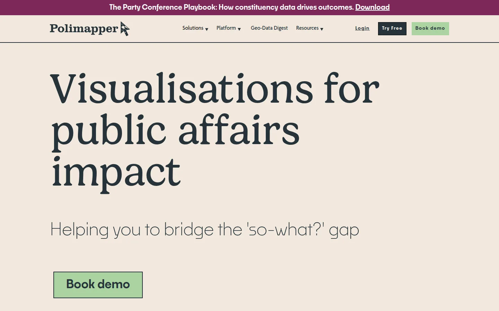</a>
      <h3>Polimapper <code>SaaS Platform · 2026</code></h3>
      Geospatial intelligence platform for public-affairs teams: interactive maps, stakeholder tools, a page builder and role-based dashboards. 
      React · TypeScript · Mapbox GL · MapLibre · Highcharts · Zustand · TanStack Query
    </td>
  </tr>
  <tr>
    <td width="50%" valign="top">
      <a href="https://unihome-academy.com/">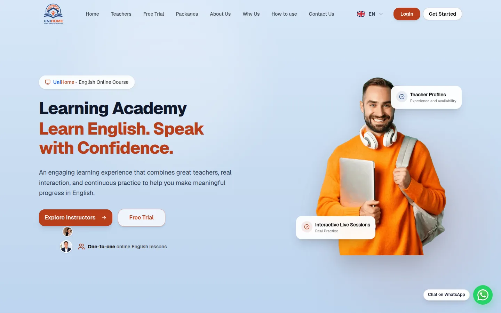</a>
      <h4>UniHome Academy <code>EdTech</code></h4>
      Bilingual online English academy: teacher booking, packages, real-time notifications. 
      Next.js 16 · React 19 · next-intl · Pusher · Laravel 10
    </td>
    <td width="50%" valign="top">
      <a href="https://www.pointsxpert.com/">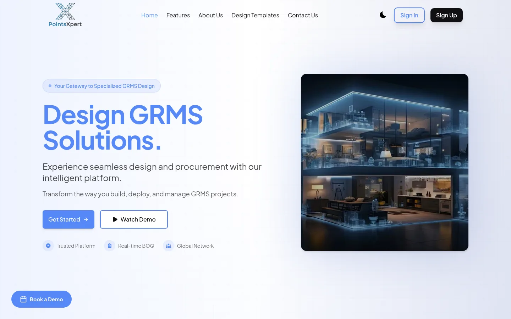</a>
      <h4>PointsXpert <code>SaaS Platform</code></h4>
      GRMS design platform: canvas room layouts, instant BOQ, Excel/PDF export. 
      Next.js · Supabase · Konva · React Flow · AG Grid
    </td>
  </tr>
  <tr>
    <td width="50%" valign="top">
      <a href="https://www.estockeh.com/">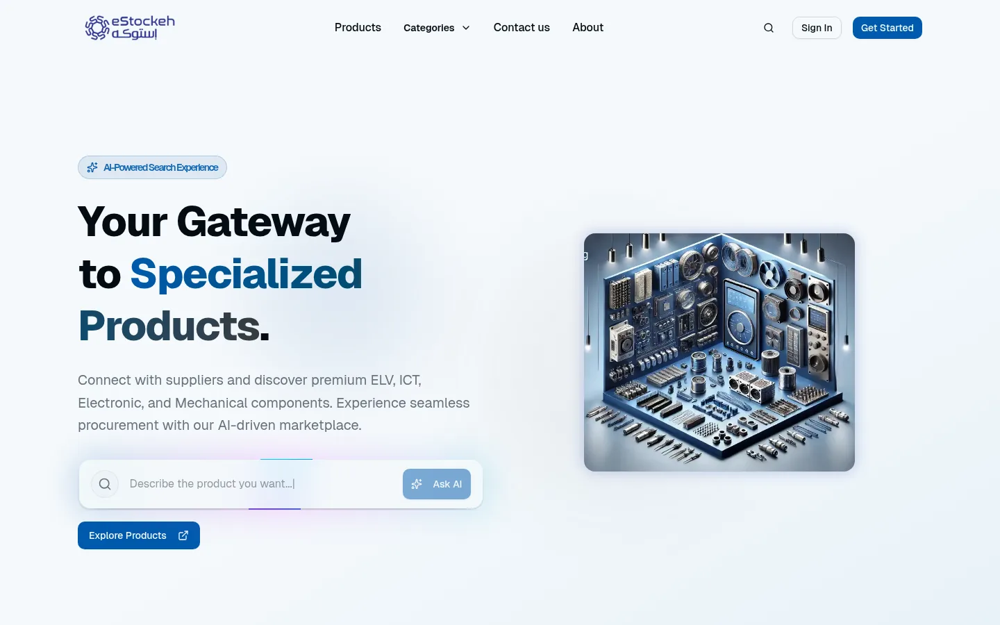</a>
      <h4>eStockeh <code>Marketplace</code></h4>
      AI-powered B2B marketplace for ELV, ICT and mechanical components. 
      Next.js · TypeScript · Tailwind CSS · shadcn/ui
    </td>
    <td width="50%" valign="top">
      <a href="https://baahland.com/">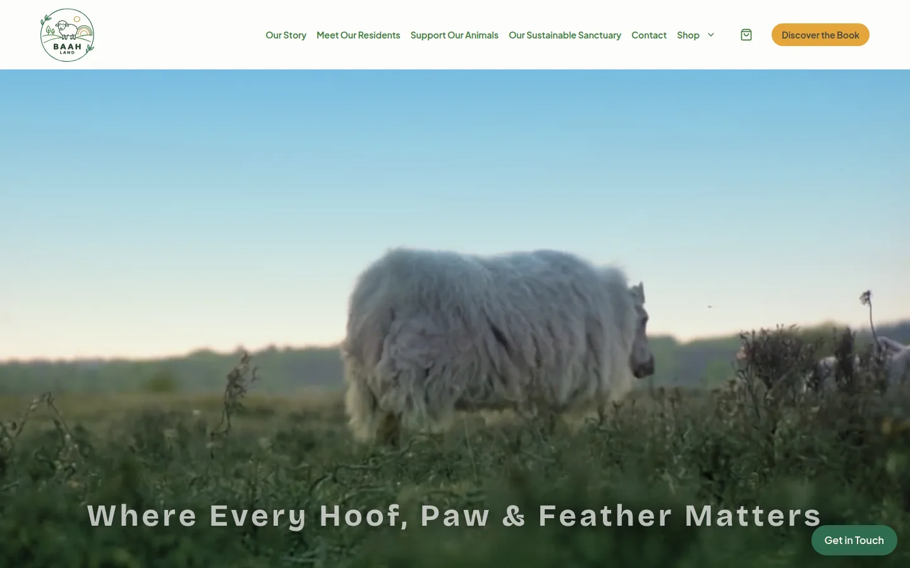</a>
      <h4>Baah Land <code>Website + Shop</code></h4>
      Website and shop for an independent animal sanctuary in Devon. 
      Laravel · Inertia.js · React · Tailwind CSS
    </td>
  </tr>
  <tr>
    <td width="50%" valign="top">
      <a href="https://scecl.co.uk/">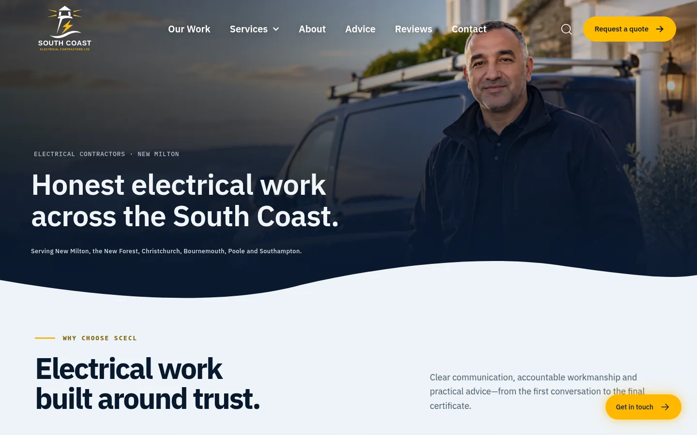</a>
      <h4>SCECL <code>WordPress</code></h4>
      Lead-generating site for a UK electrical contractor with local-SEO pages. 
      WordPress · Elementor · PHP · Local SEO
    </td>
    <td width="50%" valign="top">
      <a href="https://plumpclinics.com/">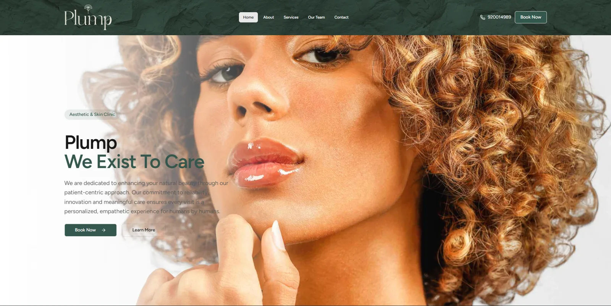</a>
      <h4>Plump Clinics <code>Healthcare</code></h4>
      Clinic operations: patient booking, treatments and dashboards. 
      React · Inertia.js · Laravel · shadcn/ui
    </td>
  </tr>
  <tr>
    <td width="50%" valign="top">
      <a href="https://www.medeucare.com/">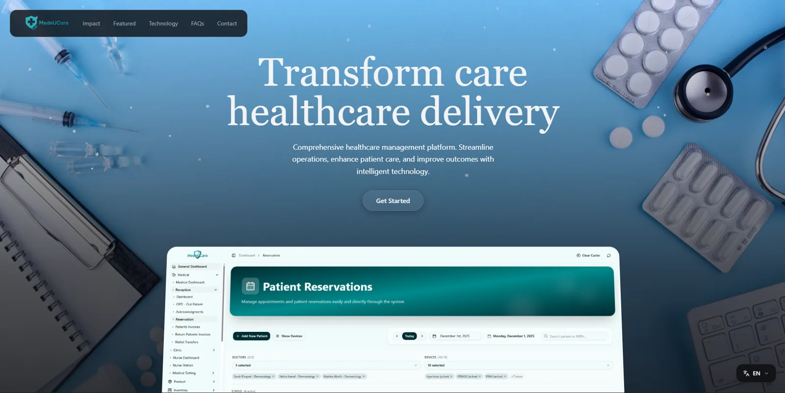</a>
      <h4>Medeucare <code>Healthcare</code></h4>
      Connects international patients with European healthcare providers. 
      React · Inertia.js · Laravel · TypeScript
    </td>
    <td width="50%" valign="top">
      <a href="https://gym-front-v2.vercel.app">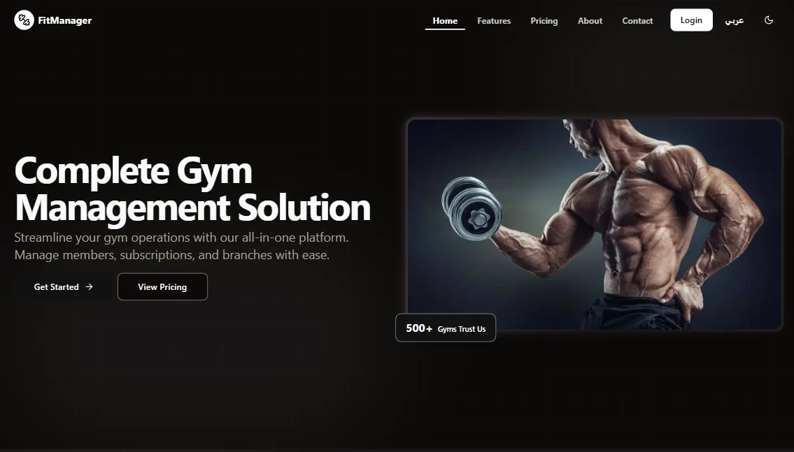</a>
      <h4>Gym Platform <code>Web App</code></h4>
      Fitness management with member and trainer dashboards. 
      Next.js · Redux Toolkit · React Query · ASP.NET
    </td>
  </tr>
</table>

<a href="https://www.magdyaboelnour.me/#projects"><b>Live previews and case studies on my portfolio →</b></a>

## `05` &nbsp;Every project ships with

<picture>
  <source media="(prefers-color-scheme: dark)" srcset="./assets/quality-dark.svg" />
  <source media="(prefers-color-scheme: light)" srcset="./assets/quality-light.svg" />
  
</picture>

Technical SEO · Core Web Vitals · image &amp; code-splitting optimisation · WCAG 2.2 AA · Lighthouse audits

## `06` &nbsp;Tech stack

      

Also: Zustand · TanStack Query · Redux Toolkit · React Hook Form · Zod · shadcn/ui · Framer Motion · GSAP · Mapbox GL · MapLibre · Leaflet · Highcharts · ECharts · OpenSearch · Inertia.js · Elementor

## `07` &nbsp;Activity

  <a href="https://github.com/magdy246">
    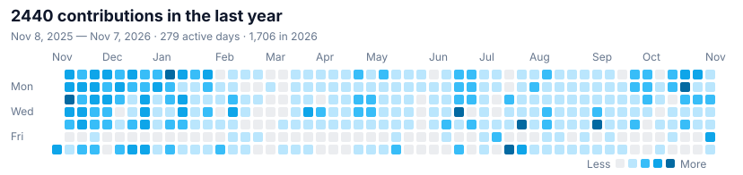
  </a>
   
  Live data · rolling 365 days · refreshed daily by GitHub Actions

## `08` &nbsp;Let's build something

Have a product to build, a dashboard to ship, or a role on your team? Send me a message and let's talk.

  

 

